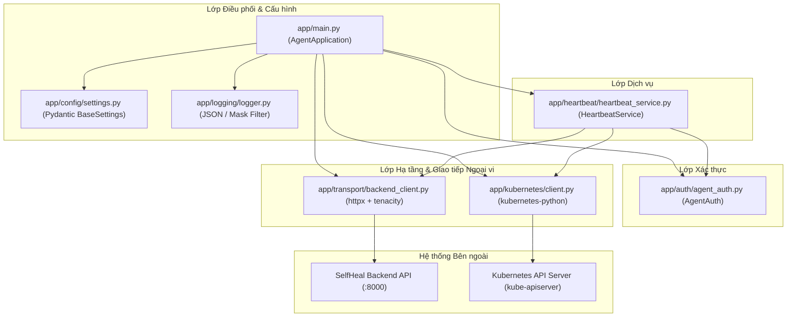

# BÁO CÁO THIẾT KẾ VÀ TỔNG HỢP THAY ĐỔI: SELFHEAL KUBERNETES AGENT v0.1

> **Phiên bản:** Agent v0.1 Foundation  
> **Thời điểm cập nhật:** 2026-09-30  
> **Tác giả:** Senior Python Backend & Kubernetes Systems Engineer  
> **Trạng thái:** Hoàn tất thiết kế & Kiểm thử thực nghiệm 100% đạt yêu cầu

---

## 1. TỔNG QUAN VÀ MỤC TIÊU PHIÊN BẢN v0.1

Agent v0.1 đóng vai trò là daemon thu thập dữ liệu (telemetry & discovery agent) chạy trên cụm Kubernetes của doanh nghiệp SME hoặc máy trạm phát triển cục bộ, định kỳ liên lạc và báo cáo trạng thái về **SelfHeal Backend**.

### Nguyên tắc và Ràng buộc cốt tử đã tuân thủ:
- **KHÔNG AI / Không tự động ra quyết định tự phục hồi** (dành cho các phiên bản tiếp theo).
- **KHÔNG thực hiện thao tác mang tính phá hủy** (destructive operations: delete, patch, restart, scale, rollback).
- **KHÔNG dùng shell subprocess gọi lệnh `kubectl`**; toàn bộ tương tác thực hiện qua **Kubernetes Python Client chính thức** (`kubernetes`).
- **KHÔNG kết nối trực tiếp cơ sở dữ liệu (PostgreSQL)**; mọi dữ liệu gửi nhận đều qua giao thức HTTP/HTTPS với SelfHeal Backend.
- **KHÔNG hardcode secrets**; bảo vệ tuyệt đối chuỗi Token xác thực bằng `SecretStr` và bộ lọc Logging Regex Redactor.
- **KHÔNG làm sập tiến trình (Crash-resistant)** khi Backend tạm thời mất kết nối.

---

## 2. KIẾN TRÚC VÀ RÀNH GIỚI PHỤ THUỘC (DEPENDENCY SEPARATION)

Hệ thống được thiết kế theo nguyên lý **Đảo ngược phụ thuộc (Dependency Inversion)**:



---

## 3. DANH SÁCH TỆP & CÁC THAY ĐỔI ĐÃ TRIỂN KHAI

### 3.1. Nhóm Cấu hình & Bảo mật
* **`selfheal-agent/app/config/constants.py`**:
  * Định nghĩa Enum `KubernetesMode` (`LOCAL`, `IN_CLUSTER`) và `AgentStatus` (`STARTING`, `HEALTHY`, `DEGRADED`, `UNHEALTHY`, `STOPPING`).
  * Các hằng số mặc định: `HEARTBEAT_ENDPOINT = "/api/v1/agents/heartbeat"`, timeouts và interval.
* **`selfheal-agent/app/config/settings.py`**:
  * Sử dụng `pydantic-settings` kế thừa `BaseSettings`.
  * Validate các trường bắt buộc: `SELFHEAL_BACKEND_URL`, `SELFHEAL_AGENT_ID`, `SELFHEAL_AGENT_TOKEN`.
  * Biến `SELFHEAL_AGENT_TOKEN` sử dụng `pydantic.SecretStr` ngăn ngừa hoàn toàn việc lộ token qua `str()`, `repr()`, debug prints hoặc JSON dumps vô tình.
  * Tự động chuẩn hóa URL (strip trailing slashes).
* **`selfheal-agent/app/auth/agent_auth.py`**:
  * Lớp `AgentAuth` quản lý thông tin xác thực Agent.
  * Cung cấp phương thức `get_auth_headers()` tạo headers `X-Agent-ID`, `Authorization: Bearer <token>`, `User-Agent`.
  * Phương thức `get_masked_token()` che giấu token theo dạng `sh_s...1234` phục vụ log kiểm toán an toàn.

### 3.2. Nhóm Structured Logging & Bảo vệ Dữ liệu Nhạy cảm
* **`selfheal-agent/app/logging/logger.py`**:
  * Cung cấp 2 định dạng: `json` (chuẩn công nghiệp cho ELK/CloudWatch) và `text` (cho local terminal).
  * Bộ lọc `SensitiveDataMaskFilter`: tự động quét nội dung text log và tham số truyền vào bằng Regular Expressions để thay thế token và bearer string bằng `***REDACTED***`.

### 3.3. Nhóm HTTP Transport & Heartbeat Telemetry
* **`selfheal-agent/app/transport/models.py`**:
  * Schema `HeartbeatPayload`:
    * `agentId`: Mã định danh Agent.
    * `agentVersion`: Phiên bản Agent (`0.1.0`).
    * `status`: Trạng thái Agent (`HEALTHY`, `DEGRADED`, ...).
    * `reportedAt`: Thời gian UTC định dạng ISO-8601.
    * `metadata`: Telemetry phụ trợ (trạng thái kết nối k8s, mode hoạt động).
  * Schema `HeartbeatResponse`: Payload phản hồi từ Backend.
* **`selfheal-agent/app/transport/backend_client.py`**:
  * Sử dụng thư viện `httpx.AsyncClient` bất đồng bộ.
  * Cấu hình tường minh `connect_timeout` (5s) và `request_timeout` (10s).
  * Tích hợp `tenacity` retry: tự động retry với **Exponential Backoff** (tối đa 3 lần, giãn cách 1s đến 4s) khi xảy ra sự cố mạng (`httpx.TransportError`, `httpx.TimeoutException`) hoặc server trả về lỗi `5xx`.
  * Bắt lỗi và đóng gói thành `BackendConnectionError`, bảo đảm tầng Service xử lý an toàn không làm crash chương trình.
* **`selfheal-agent/app/heartbeat/heartbeat_service.py`**:
  * Vòng lặp định kỳ (`asyncio.Task`) chạy ngầm không chặn main thread.
  * Khi gửi pulse: tự động tổng hợp metadata kết nối Kubernetes hiện thời.
  * **Khả năng chịu lỗi (Fault-Tolerance):** Nếu Backend offline hoặc từ chối kết nối, service ghi log cảnh báo và tiếp tục lặp lại ở chu kỳ tiếp theo (`SELFHEAL_HEARTBEAT_INTERVAL`).
  * Hỗ trợ Graceful Cancellation: gửi tín hiệu `STOPPING` trước khi dừng hoàn toàn.

### 3.4. Nhóm Kết nối & Khảo sát Kubernetes
* **`selfheal-agent/app/kubernetes/client.py`**:
  * Lớp `KubernetesClient` bọc chính thức `kubernetes.client`.
  * Hỗ trợ 2 chế độ:
    * `LOCAL`: Tải cấu hình từ `~/.kube/config` hoặc tệp tùy biến qua `KUBECONFIG_PATH`.
    * `IN_CLUSTER`: Gọi `config.load_incluster_config()` sử dụng ServiceAccount token gắn trong Pod.
  * Phương thức `check_connectivity()`: gọi Version API kiểm tra API server còn sống hay không và trích xuất `git_version`, `platform`.
  * Cung cấp các hàm khảo sát chỉ đọc (Read-only discovery stubs): `list_nodes`, `list_namespaces`, `list_pods`, `list_deployments`, `list_services`, `list_events`.

### 3.5. Nhóm Điều phối Vòng đời & Tắt An toàn
* **`selfheal-agent/app/main.py`**:
  * Lớp `AgentApplication` khởi tạo các dependency theo đúng trình tự.
  * Đăng ký bộ lắng nghe tín hiệu OS `SIGINT` (Ctrl+C) và `SIGTERM` (chuẩn container termination).
  * **Graceful Shutdown**:
    1. Thông báo hủy tác vụ Heartbeat và gửi thông điệp trạng thái cuối.
    2. Đóng phiên kết nối mạng HTTP của `httpx`.
    3. Ghi log hoàn tất chu trình và thoát an toàn.

---

## 4. KẾT QUẢ KIỂM THỬ XÁC MINH (VERIFICATION RESULTS)

Đã khởi tạo bộ kiểm thử tự động tại `selfheal-agent/tests/test_agent.py` và chạy thực thi thành công:

```
============================= test session starts =============================
platform win32 -- Python 3.14.4, pytest-9.1.1, pluggy-1.6.0
collected 6 items

selfheal-agent/tests/test_agent.py::test_settings_validation_and_secrets PASSED [ 16%]
selfheal-agent/tests/test_agent.py::test_agent_auth_headers_and_masking PASSED [ 33%]
selfheal-agent/tests/test_agent.py::test_sensitive_data_log_mask_filter PASSED [ 50%]
selfheal-agent/tests/test_agent.py::test_heartbeat_payload_serialization PASSED [ 66%]
selfheal-agent/tests/test_agent.py::test_heartbeat_service_resilience_on_backend_failure PASSED [ 83%]
selfheal-agent/tests/test_agent.py::test_kubernetes_client_safe_local_failure PASSED [100%]

============================== 6 passed in 0.78s ==============================
```
