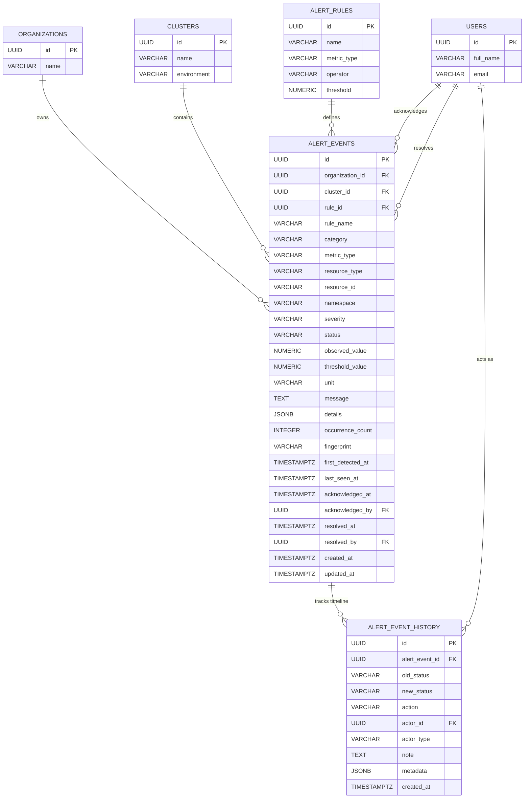
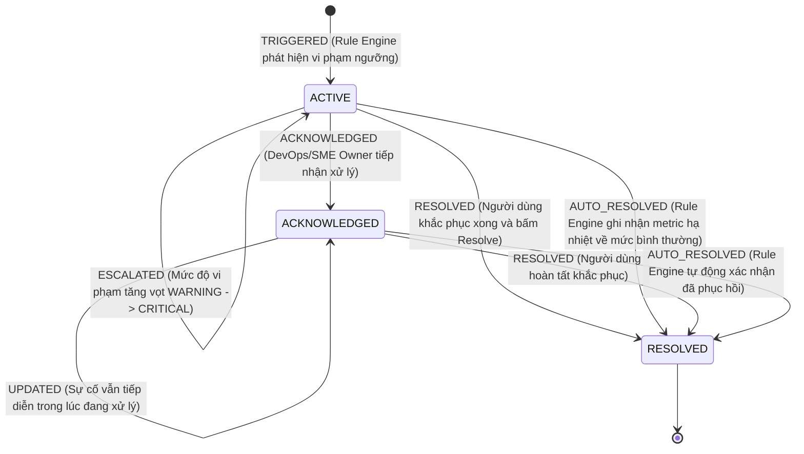

# TÀI LIỆU PHÂN TÍCH YÊU CẦU & THIẾT KẾ MÔ HÌNH DỮ LIỆU LỊCH SỬ CẢNH BÁO
## SPRINT 5 — PBI22 — TASK 4.1

- **Dự án**: AegisAI – AI-Driven Proactive Self-Healing Infrastructure for SMEs
- **Mã Task**: `[S5][PBI22] 4.1`
- **Tác giả**: Senior Full-stack Engineer, Software Architect & QA Engineer
- **Trạng thái**: Hoàn thành (Implemented & Verified)
- **Phiên bản Schema**: Migration 18 (`18_create_alert_event_history.sql`)

---

## 1. Mục tiêu và Phạm vi (Goals & Scope)

### 1.1. Mục tiêu
Thiết kế kiến trúc lưu trữ dữ liệu lịch sử cảnh báo (Alert History) và dòng thời gian chuyển đổi trạng thái (Lifecycle Timeline) phục vụ hệ thống giám sát và tự phục hồi AegisAI. Cung cấp nền tảng dữ liệu để:
1. Lưu vết chính xác mọi trạng thái trong vòng đời cảnh báo: `TRIGGERED`, `UPDATED`, `ESCALATED`, `ACKNOWLEDGED`, `RESOLVED`, `AUTO_RESOLVED`, `REOPENED`.
2. Phân biệt tường minh các mốc thời gian: thời điểm phát hiện lần đầu (`first_detected_at`), thời điểm ghi nhận vi phạm gần nhất (`last_seen_at`), thời điểm tiếp nhận xử lý (`acknowledged_at`), thời điểm giải quyết hoàn tất (`resolved_at`) và thời gian tồn tại của sự cố (`duration_seconds`).
3. Truy vấn, lọc nhiều chiều (Severity, Status, Time Range, Cluster, Rule, Resource Type, Namespace) và tìm kiếm toàn văn nhanh chóng mà không gây quá tải cơ sở dữ liệu.
4. Đảm bảo toàn vẹn dữ liệu, chống suy thoái lịch sử khi cập nhật trạng thái hoặc deduplication.
5. Bảo đảm cô lập đa người thuê (Multi-tenant Organization Isolation) và kiểm soát truy cập dựa trên vai trò (RBAC).

### 1.2. Phạm vi
- **In-Scope**:
  - Bổ sung các thuộc tính mở rộng cho bảng `alert_events` (`resolved_by`, `namespace`).
  - Thiết kế bảng mới `alert_event_history` liên kết `1:N` với `alert_events`.
  - Thiết lập các chỉ mục tối ưu cho truy vấn lọc chuỗi thời gian, trạng thái, phân trang và tìm kiếm.
  - Xây dựng cơ chế ghi nhận lịch sử tự động bên trong `AlertLifecycleService` khi kích hoạt, leo thang, xác nhận, hoặc giải quyết cảnh báo.
  - Xây dựng cụm API `/api/v1/alerts/history`, `/history/summary`, `/history/:id`, `/history/:id/timeline`.
- **Out-of-Scope**:
  - Tích hợp gửi email/SMS thông báo (nằm trong phạm vi module Notification PBI riêng).

---

## 2. Yêu cầu Chức năng (Functional Requirements)

- **FR-01 (Truy vấn theo phạm vi tổ chức/cụm)**: Người dùng xem được toàn bộ danh sách cảnh báo thuộc Organization và Cluster mà họ được cấp quyền.
- **FR-02 (Xem trạng thái vòng đời)**: Xem được danh sách cảnh báo ở tất cả các trạng thái (`ACTIVE`, `ACKNOWLEDGED`, `RESOLVED`).
- **FR-03 (Bộ lọc Severity)**: Lọc theo mức độ nghiêm trọng: `ALL`, `INFO`, `WARNING`, `CRITICAL`.
- **FR-04 (Bộ lọc Status)**: Lọc theo trạng thái: `ALL`, `ACTIVE`, `ACKNOWLEDGED`, `RESOLVED`.
- **FR-05 (Bộ lọc Thời gian)**: Lọc linh hoạt theo các preset (`24 giờ qua`, `7 ngày qua`, `30 ngày qua`, `Tất cả`) và khoảng thời gian tùy chỉnh (`startDate` đến `endDate`).
- **FR-06 (Tìm kiếm toàn văn)**: Tìm kiếm linh hoạt theo tiêu đề quy tắc (`rule_name`), nội dung mô tả (`message`), định danh tài nguyên (`resource_id`), và `namespace`.
- **FR-07 (Kết hợp đa bộ lọc)**: Cho phép kết hợp đồng thời nhiều tiêu chí lọc (`severity + status + time + cluster + search`) trong một truy vấn duy nhất.
- **FR-08 (Phân trang & Sắp xếp)**: Hỗ trợ phân trang phía server (`page`, `limit`), giới hạn tối đa `limit <= 100`, và sắp xếp theo các cột (`first_detected_at`, `last_seen_at`, `severity`, `status`, `resolved_at`).
- **FR-09 (Xem chi tiết & Timeline)**: Xem chi tiết toàn bộ metadata của cảnh báo kèm dòng thời gian (`Timeline`) các sự kiện chuyển đổi trạng thái theo thứ tự thời gian tăng dần (`created_at ASC`).
- **FR-10 (Thống kê Lịch sử)**: Cung cấp API tổng hợp số liệu tổng quan lịch sử (`Total Alerts`, `Critical`, `Warning`, `Info`, `Resolved`, `Active`, `Acknowledged`).

---

## 3. Yêu cầu Phi chức năng (Non-functional Requirements)

- **NFR-01 (Hiệu năng truy vấn)**: Tốc độ phản hồi API truy vấn lịch sử phân trang đạt dưới 100ms trên tập dữ liệu hàng chục nghìn bản ghi thông qua hệ thống B-Tree index chuyên biệt.
- **NFR-02 (Bảo toàn dữ liệu)**: Không bao giờ xóa đè hoặc xóa cứng dữ liệu lịch sử trạng thái cũ. Mọi thay đổi trạng thái phải tạo một bản ghi mới trong `alert_event_history`.
- **NFR-03 (Bảo mật & Isolation)**: Ngăn chặn triệt để rò rỉ dữ liệu giữa các tổ chức (Cross-tenant leak). Tổ chức A tuyệt đối không thể đọc hay suy đoán được dữ liệu cảnh báo của Tổ chức B.
- **NFR-04 (Tính toàn vẹn Transaction)**: Thao tác cập nhật trạng thái của `alert_events` và ghi bản ghi `alert_event_history` phải được bọc trong cùng một Database Transaction (`BEGIN ... COMMIT`), tránh tình trạng event đổi trạng thái nhưng thiếu history.
- **NFR-05 (Tương thích ngược)**: Không làm phá vỡ hoặc gián đoạn hoạt động của các module đã triển khai ở Sprint 5 PBI21 (Alert Rules, Rule Engine, Deduplication, Dynamic Severity).

---

## 4. Quy tắc Nghiệp vụ (Business Rules)

1. **BR-01 (Định danh Vòng đời)**:
   - Khi một sự cố vi phạm ngưỡng lần đầu tiên xuất hiện -> tạo `alert_events` với `status = 'ACTIVE'`, ghi nhận `alert_event_history` với `action = 'TRIGGERED'`, `actor_type = 'SYSTEM'`.
   - Nếu sự cố tiếp tục tái diễn trong chu kỳ kế tiếp -> tăng `occurrence_count`, cập nhật `last_seen_at`, nếu mức độ vi phạm leo thang (ví dụ từ `WARNING` lên `CRITICAL`) -> ghi nhận `alert_event_history` với `action = 'ESCALATED'`.
2. **BR-02 (Xác nhận Tiếp nhận - Acknowledge)**:
   - Chỉ cho phép xác nhận cảnh báo đang ở trạng thái `ACTIVE`.
   - Không cho phép xác nhận cảnh báo đã ở trạng thái `RESOLVED`.
   - Ghi nhận `acknowledged_at = NOW()`, `acknowledged_by = current_user_id`, và thêm bản ghi `alert_event_history` với `action = 'ACKNOWLEDGED'`, `actor_type = 'USER'`.
3. **BR-03 (Giải quyết Cảnh báo - Resolve)**:
   - Cảnh báo có thể được giải quyết thủ công bởi người dùng (`action = 'RESOLVED'`, `actor_type = 'USER'`, ghi nhận `resolved_by = current_user_id`), hoặc tự động bởi Rule Engine khi hạ tầng bình thường trở lại (`action = 'AUTO_RESOLVED'`, `actor_type = 'SYSTEM'`).
   - Cập nhật `resolved_at = NOW()`, `status = 'RESOLVED'`.
4. **BR-04 (Tính toán Thời gian Sự cố - Duration)**:
   - `duration_seconds = EXTRACT(EPOCH FROM (COALESCE(resolved_at, NOW()) - first_detected_at))`
   - Đảm bảo hiển thị trực quan cho người dùng theo định dạng: ví dụ `45s`, `12m 30s`, `3h 15m`, `2d 4h`.

---

## 5. Mô hình Thực thể Quan hệ (Entity Relationship Diagram - ERD)

---

## 6. Từ điển Dữ liệu (Data Dictionary)

### 6.1. Bảng `alert_events` (Đã bổ sung trong Migration 18)

| Tên Cột | Kiểu Dữ liệu | Ràng buộc | Mô tả Nghiệp vụ |
| :--- | :--- | :--- | :--- |
| `id` | `UUID` | `PRIMARY KEY` | Khóa chính duy nhất định danh sự kiện cảnh báo. |
| `organization_id` | `UUID` | `NOT NULL, FK -> organizations(id)` | Khóa ngoại xác định đơn vị sở hữu (Multi-tenant guard). |
| `cluster_id` | `UUID` | `NULLABLE, FK -> clusters(id)` | Khóa ngoại xác định cụm Kubernetes hoặc VPS (nếu có). |
| `rule_id` | `UUID` | `NULLABLE, FK -> alert_rules(id)` | Quy tắc cảnh báo kích hoạt sự kiện. |
| `rule_name` | `VARCHAR(255)`| `NOT NULL` | Tên quy tắc tại thời điểm kích hoạt. |
| `category` | `VARCHAR(50)` | `CHECK ('RESOURCE', 'KUBERNETES', 'APM')` | Phân loại nguồn gốc cảnh báo. |
| `metric_type` | `VARCHAR(50)` | `NOT NULL` | Loại chỉ số (CPU, RAM, DISK, POD_CRASH_LOOP, HTTP_5XX_RATE, ...). |
| `resource_type` | `VARCHAR(50)` | `NOT NULL` | Loại tài nguyên (`node`, `pod`, `service`, `workload`). |
| `resource_id` | `VARCHAR(255)`| `NOT NULL` | Định danh tài nguyên bị cảnh báo (Node name, Pod name, Service name). |
| `namespace` | `VARCHAR(255)`| `NULLABLE` | **[Mới - M18]** Namespace Kubernetes chứa tài nguyên bị cảnh báo. |
| `severity` | `VARCHAR(50)` | `CHECK ('INFO', 'WARNING', 'CRITICAL')` | Mức độ nghiêm trọng tại thời điểm quan sát. |
| `status` | `VARCHAR(50)` | `CHECK ('ACTIVE', 'ACKNOWLEDGED', 'RESOLVED')` | Trạng thái vòng đời hiện tại của cảnh báo. |
| `observed_value` | `NUMERIC(14,2)`| `NULLABLE` | Giá trị đo đạc thực tế gần nhất của metric. |
| `threshold_value`| `NUMERIC(14,2)`| `NULLABLE` | Ngưỡng cấu hình được so sánh. |
| `unit` | `VARCHAR(50)` | `NULLABLE` | Đơn vị đo lường (%, ms, req/s, restarts, ...). |
| `message` | `TEXT` | `NOT NULL` | Nội dung thông điệp cảnh báo hiển thị cho người dùng. |
| `details` | `JSONB` | `DEFAULT '{}'::jsonb` | Dữ liệu ngữ cảnh mở rộng (nguyên nhân, nhãn, cấu hình so sánh). |
| `occurrence_count`| `INTEGER` | `NOT NULL DEFAULT 1` | Số chu kỳ vi phạm liên tiếp ghi nhận được (Deduplication). |
| `fingerprint` | `VARCHAR(64)` | `NULLABLE` | Mã băm SHA-256 duy nhất dùng để gộp và chống trùng lặp. |
| `first_detected_at`| `TIMESTAMPTZ`| `NOT NULL DEFAULT NOW()` | Thời điểm sự cố bắt đầu phát sinh chu kỳ đầu tiên. |
| `last_seen_at` | `TIMESTAMPTZ`| `NOT NULL DEFAULT NOW()` | Thời điểm sự cố được kiểm tra và ghi nhận gần nhất. |
| `acknowledged_at`| `TIMESTAMPTZ`| `NULLABLE` | Thời điểm người dùng tiếp nhận và xác nhận cảnh báo. |
| `acknowledged_by`| `UUID` | `NULLABLE, FK -> users(id)` | Người dùng thực hiện thao tác xác nhận. |
| `resolved_at` | `TIMESTAMPTZ`| `NULLABLE` | Thời điểm cảnh báo được đánh dấu giải quyết hoàn tất. |
| `resolved_by` | `UUID` | `NULLABLE, FK -> users(id)` | **[Mới - M18]** Người dùng thực hiện thao tác giải quyết cảnh báo. |
| `created_at` | `TIMESTAMPTZ`| `NOT NULL DEFAULT NOW()` | Thời điểm bản ghi được tạo trong cơ sở dữ liệu. |
| `updated_at` | `TIMESTAMPTZ`| `NOT NULL DEFAULT NOW()` | Thời điểm bản ghi cập nhật trạng thái mới nhất. |

---

### 6.2. Bảng `alert_event_history` (Mới tạo trong Migration 18)

| Tên Cột | Kiểu Dữ liệu | Ràng buộc | Mô tả Nghiệp vụ |
| :--- | :--- | :--- | :--- |
| `id` | `UUID` | `PRIMARY KEY DEFAULT gen_random_uuid()` | Định danh duy nhất của mỗi bước chuyển trạng thái. |
| `alert_event_id` | `UUID` | `NOT NULL, FK -> alert_events(id) ON DELETE CASCADE` | Tham chiếu tới sự kiện cảnh báo tương ứng. |
| `old_status` | `VARCHAR(50)` | `NULLABLE` | Trạng thái trước khi chuyển đổi (`NULL` khi mới kích hoạt). |
| `new_status` | `VARCHAR(50)` | `NOT NULL` | Trạng thái sau khi chuyển đổi (`ACTIVE`, `ACKNOWLEDGED`, `RESOLVED`). |
| `action` | `VARCHAR(50)` | `CHECK ('TRIGGERED', 'UPDATED', 'ESCALATED', 'ACKNOWLEDGED', 'RESOLVED', 'AUTO_RESOLVED', 'REOPENED')` | Hành động kích hoạt bước chuyển đổi trạng thái. |
| `actor_id` | `UUID` | `NULLABLE, FK -> users(id) ON DELETE SET NULL` | Người dùng thực hiện thao tác (nếu có). |
| `actor_type` | `VARCHAR(50)` | `CHECK ('SYSTEM', 'USER', 'AGENT')` | Phân loại tác nhân kích hoạt hành động. |
| `note` | `TEXT` | `NULLABLE` | Ghi chú, giải thích lý do tiếp nhận hoặc xử lý cảnh báo. |
| `metadata` | `JSONB` | `DEFAULT '{}'::jsonb` | Dữ liệu ngữ cảnh tại thời điểm ghi vết (observed value, payload). |
| `created_at` | `TIMESTAMPTZ`| `NOT NULL DEFAULT NOW()` | Thời điểm chính xác sự kiện lịch sử xảy ra. |

---

## 7. Chỉ mục & Ràng buộc Dữ liệu (Indexes & Constraints)

### 7.1. Bảng `alert_events`
- `idx_alert_events_org`: `(organization_id)` — Lọc theo tổ chức.
- `idx_alert_events_cluster`: `(cluster_id)` — Lọc theo cụm.
- `idx_alert_events_status`: `(status)` — Lọc nhanh theo trạng thái.
- `idx_alert_events_severity`: `(severity)` — Lọc theo mức độ nghiêm trọng.
- `idx_alert_events_detected_at`: `(first_detected_at DESC)` — Sắp xếp theo thời gian phát hiện.
- `idx_alert_events_last_seen`: `(last_seen_at DESC)` — Sắp xếp theo lần cuối ghi nhận.
- `idx_alert_events_namespace`: `(namespace)` — **[Mới - M18]** Tìm kiếm và lọc theo namespace K8s.
- `idx_alert_events_resolved_by`: `(resolved_by)` — **[Mới - M18]** Lọc theo người giải quyết.
- `idx_alert_events_org_created`: `(organization_id, created_at DESC)` — **[Mới - M18]** Lọc lịch sử phân trang theo tổ chức và thời gian tạo.
- `idx_alert_events_org_last_seen`: `(organization_id, last_seen_at DESC)` — **[Mới - M18]** Lọc sự cố gần nhất theo tổ chức.
- `uq_open_alert_event`: Partial Unique Index trên `(organization_id, cluster_id, rule_id, resource_type, resource_id, metric_type) WHERE status != 'RESOLVED'` — Chống trùng lặp cảnh báo mở.

### 7.2. Bảng `alert_event_history`
- `idx_alert_event_history_event_id`: `(alert_event_id)` — Truy vấn toàn bộ timeline của một cảnh báo cụ thể.
- `idx_alert_event_history_created_at`: `(created_at ASC)` — Sắp xếp các mốc timeline theo thứ tự thời gian chuẩn xác.
- `idx_alert_event_history_action`: `(action)` — Thống kê tần suất các loại hành động.
- `idx_alert_event_history_actor`: `(actor_id)` — Truy vết kiểm toán theo người dùng.

---

## 8. Sơ đồ Vòng đời Cảnh báo & Dòng thời gian (Alert Lifecycle State Diagram)

---

## 9. Cơ chế Phân quyền (RBAC) & Cô lập Dữ liệu Tổ chức (Organization Isolation)

1. **Organization Isolation**:
   - Mọi truy vấn `alert_events` và `alert_event_history` đều phải bắt buộc có điều kiện `ae.organization_id = $1` lấy từ Token xác thực hoặc header `X-Organization-Id` đã qua kiểm định vai trò hợp lệ.
   - Khi truy vấn `GET /api/v1/alerts/history/:id` hoặc `:id/timeline`, Backend kiểm tra trực tiếp quyền sở hữu của tổ chức trước khi trả về dữ liệu. Nếu ID thuộc tổ chức khác -> trả về `404 Not Found` (không để lộ sự tồn tại của ID).
2. **Cluster Isolation**:
   - Hỗ trợ lọc theo `cluster_id` đối với các sự cố gắn liền với cụm Kubernetes, hoặc lấy các cảnh báo ở phạm vi tổ chức chung (`cluster_id IS NULL`).
3. **Phân quyền vai trò (RBAC)**:
   - `SME_OWNER`, `DEVOPS`, `ADMIN`, `SUPER_ADMIN`: Toàn quyền xem danh sách, lọc, tìm kiếm, xem timeline, thực hiện thao tác Acknowledge, Resolve, và cấu hình quy tắc.
   - `VIEWER`, `USER`: Được cấp quyền xem danh sách lịch sử cảnh báo, xem chi tiết và timeline sự kiện; bị chặn (HTTP 403 Forbidden hoặc ẩn trên giao diện) đối với các hành động ghi đè, Acknowledge hoặc Resolve.

---

## 10. Chiến lược Migration (Migration Strategy)

- **File Migration**: `Main_backend/migrations/18_create_alert_event_history.sql`.
- **Cơ chế An toàn**:
  - Sử dụng mệnh đề `ADD COLUMN IF NOT EXISTS` và `CREATE TABLE IF NOT EXISTS` để đảm bảo tính Idempotent (chạy nhiều lần không gây lỗi).
  - Tự động backfill dữ liệu `namespace` từ trường `details->>'namespace'` đối với các cảnh báo đã tồn tại.
  - Tự động backfill các bản ghi lịch sử khởi đầu (`TRIGGERED`, `ACKNOWLEDGED`, `RESOLVED`) cho toàn bộ 26 bản ghi `alert_events` hiện có trong database để đảm bảo khi mở Timeline không bị rỗng.
- **Khả năng Rollback**:
  - Xóa bảng `alert_event_history`: `DROP TABLE IF EXISTS alert_event_history;`
  - Gỡ các cột mở rộng: `ALTER TABLE alert_events DROP COLUMN IF EXISTS resolved_by, DROP COLUMN IF EXISTS namespace;`

---

## 11. Tiêu chí Nghiệm thu (Acceptance Criteria)

1. Migration 18 đã được thực thi thành công trên database PostgreSQL thực tế (`alert_event_history` đã được tạo và chứa dữ liệu).
2. Bảng `alert_events` chứa đầy đủ các trường `namespace`, `resolved_by` và các index tương ứng.
3. API `/api/v1/alerts/history` hỗ trợ đầy đủ các tham số lọc: `severity`, `status`, `startDate`, `endDate`, `search`, `clusterId`, `ruleId`, `resourceType`, `page`, `limit`, `sortBy`, `sortOrder`.
4. API `/api/v1/alerts/history/:id/timeline` trả về danh sách sự kiện lịch sử sắp xếp theo thứ tự thời gian tăng dần (`created_at ASC`).
5. API `/api/v1/alerts/history/summary` tổng hợp chính xác số liệu `total_alerts`, `critical_alerts`, `warning_alerts`, `info_alerts`, `resolved_alerts`, `active_alerts`, `acknowledged_alerts`.
6. Validation chặt chẽ: từ chối nếu `startDate > endDate` hoặc truyền sai format severity/status.
7. Đảm bảo 100% không ảnh hưởng hoặc phá vỡ các chức năng cảnh báo của PBI21.
