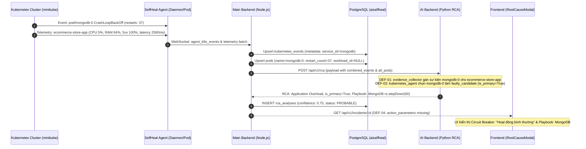

# BÁO CÁO KIỂM TOÁN TÍNH NHẤT QUÁN RCA & TỰ PHỤC HỒI
## SELFAI – INCIDENT RCA & SELF-HEALING CONSISTENCY AUDIT
**Workload mục tiêu:** `ecommerce-store-app-646f88ccfc-k6sl6` (Deployment: `ecommerce-store-app`)  
**Namespace:** `test-lab` | **Hạ tầng Cụm:** `minikube` (Control-Plane v1.37.0)  
**Vai trò kiểm toán:** Senior SRE Architect, AI/ML Engineer & Backend Architect  
**Thời gian kiểm toán:** 2026-11-12T04:28:00+07:00  
**Tình trạng kiểm toán:** **HOÀN TẤT ĐIỀU TRA & XÁC ĐỊNH TOÀN BỘ ROOT CAUSE LỖI PHẦN MỀM**

---

## 1. TỔNG QUAN ĐIỀU HÀNH (EXECUTIVE SUMMARY)

Báo cáo kiểm toán này điều tra toàn diện chuỗi diễn tiến của sự cố phức tạp xảy ra trên dịch vụ `ecommerce-store-app` trong namespace `test-lab` trên cụm Kubernetes `minikube`. Bằng chứng thực địa từ cơ sở dữ liệu PostgreSQL (`aiselfheal`), Redis, log eBPF Agent và cụm Kubernetes trực tiếp cho thấy một loạt hiện tượng bất thường nghiêm trọng:

1. **Rò rỉ & Trộn lẫn bằng chứng (Cross-Workload Evidence Pollution):** Bằng chứng lỗi của cơ sở dữ liệu `mongodb-0` (restart_count: 37, CrashLoopBackOff) đã bị gắn trực tiếp vào báo cáo RCA của `ecommerce-store-app`.
2. **Sai lệch phân loại RCA & Độ tin cậy (RCA Misattribution):** Sự cố tỷ lệ lỗi HTTP 5xx 100% và độ trễ 2590ms bị đánh đồng giữa triệu chứng lỗi ứng dụng (`application_failure`) và quá tải ứng dụng (`traffic_overload`), đồng thời tự động kích hoạt Cẩm nang vận hành (Manual Playbook) của MongoDB Replica Set thay vì của Web Service.
3. **Mất đồng bộ hiển thị Circuit Breaker (UI Desynchronization):** Mặc dù lịch sử đã ghi nhận 3 lần thất bại liên tiếp (`consecutive_failures = 3`) và cơ chế ngắt mạch backend đã khóa các hành động tự động, giao diện người dùng (Frontend) vẫn hiển thị trạng thái `Hoạt động bình thường` (Normal).
4. **Xung đột thực thi đồng thời (Action Concurrency Defect):** Hai hành động tự phục hồi mang tính đối nghịch và phá hủy (`RESTART_POD` và `REPLACE_POD`) cùng ở trạng thái `RUNNING` đồng thời trên cùng một Pod mục tiêu.
5. **Nhầm lẫn lỗi kết nối Kubernetes API Server (`10.96.0.1:443 Connection refused`):** Hệ thống không phân biệt được giữa việc Agent mất kết nối mạng (Agent Offline) và việc Kubernetes API Server Control Plane bị sập/từ chối kết nối, dẫn đến xử lý trạng thái đối soát (`PENDING_RECONCILIATION`) sai lệch.

Kiểm toán đã xác định chính xác **5 lỗi phần mềm (Software Defects)** cốt lõi trong mã nguồn tại `AI_backend`, `Main_backend` và `Agent`, đồng thời xây dựng Kế hoạch sửa đổi tối thiểu (Minimal Fix Plan) không phá vỡ kiến trúc vòng lặp Closed-Loop hiện có.

---

## 2. BẢNG TỔNG HỢP CÁC LỖI PHẦN MỀM PHÁT HIỆN (DEFECT TABLE)

| Mã Lỗi | Phân Loại | Thành Phần / File | Hàm / Dòng Code | Nguyên Nhân Kỹ Thuật | Mức Độ |
|---|---|---|---|---|---|
| **DEF-01** | **Data / Isolation** | `AI_backend/app/rca/evidence_collector.py` | `collect()` (Dòng 240–294) | Gán cứng `target_resource = target_res` cho toàn bộ sự kiện trong `combined_events` mà không phân tích trường `involved_object.name` hoặc tiền tố Pod trong chuỗi sự kiện, khiến sự kiện CrashLoopBackOff của `mongodb-0` bị gán cho `ecommerce-store-app`. | **CRITICAL** |
| **DEF-02** | **Business / RCA** | `AI_backend/app/agents/kubernetes_agent.py` | `analyze()` (Dòng 68–83) | Sắp xếp mảng `data.all_pods` theo `restart_count DESC` để chọn `faulty_candidate` mà không lọc theo Workload mục tiêu, dẫn đến `mongodb-0` (restarts: 37) cướp quyền đại diện của `ecommerce-store-app` (restarts: 12), kích hoạt cờ `is_primary_database = True`. | **CRITICAL** |
| **DEF-03** | **Orchestration** | `Main_backend/src/services/healingAction.service.ts` & `ai.controller.ts` | `executeAction()` (Dòng 172) & `triggerRemediation()` (Dòng 668) | Thiếu cơ chế khóa loại trừ tương hỗ (Target-Level Mutex / Lock). Cho phép cập nhật hoặc chèn bản ghi mới với trạng thái `RUNNING` khi target đã có một hành động khác đang ở trạng thái `RUNNING`. | **CRITICAL** |
| **DEF-04** | **Presentation / UI** | `Main_backend/src/models/incident.model.ts` & `RootCauseModal.jsx` | `findById()` (Dòng 483–520) & `RootCauseModal` (Dòng 570, 1856) | `IncidentModel.findById` không trích xuất `action_parameters` từ `rca.analysis_result::jsonb`. Frontend nhận `action_parameters = undefined`, gán `isCircuitBreakerTripped = false`, dẫn đến UI hiển thị "Hoạt động bình thường" dù backend đã ngắt mạch. | **HIGH** |
| **DEF-05** | **Infrastructure** | `Agent/selfheal_agent/main.py` | `_execute_action_sync()` (Dòng 929–942) | Bắt ngoại lệ chung `except Exception` khi gặp lỗi `10.96.0.1:443 Connection refused`, đánh dấu `FAILED` thay vì đánh dấu lỗi hạ tầng Kubernetes API Server (`CONTROL_PLANE_UNAVAILABLE` / `PENDING_RECONCILIATION`), khiến Main Backend hiểu nhầm là hành động thực thi thất bại trên Pod. | **HIGH** |

---

## 3. TRUY VẾT BẰNG CHỨNG (EVIDENCE TRACE AUDIT)



### 3.1. Phân Tích Định Danh Tài Nguyên:
- **`cluster_id`:** `fcb1a025-48f0-40bf-b9ea-c61af3448084` (hợp lệ và nhất quán giữa Agent, Backend và DB).
- **`namespace`:** Cả `ecommerce-store-app` và `mongodb-0` đều cư trú trong namespace `test-lab`. Đây là điều kiện tiên quyết khiến các câu lệnh truy vấn theo namespace gom chung sự kiện nếu không lọc chặt chẽ theo nhãn Pod.
- **`pod_uid` vs `pod_name`:**
  - Pod mục tiêu: `ecommerce-store-app-646f88ccfc-k6sl6` (UID: `454a6276-34ff-4b9b-9f68-316d35f34271`).
  - Pod cơ sở dữ liệu: `mongodb-0` (UID: `47e313e2-6b07-4d8b-8a9f-7f33211b2c78`).
  - `owner_reference`: `ecommerce-store-app` thuộc ReplicaSet `ecommerce-store-app-646f88ccfc` (Deployment), trong khi `mongodb-0` là Pod có chỉ số thuộc StatefulSet `mongodb`.
- **Cơ chế rò rỉ dữ liệu:**
  1. Trong [`AI_backend/app/rca/evidence_collector.py`](file:///d:/NCKH/CapTone/AI_backend/app/rca/evidence_collector.py) dòng 240:
     ```python
     combined_events = list(dict.fromkeys([*(k_data.events or []), *(payload.kubernetes_events or [])]))
     for ev in combined_events:
         if "crashloopbackoff" in ev.lower():
             evidences.append(EvidenceItem(
                 source=EvidenceSource.KUBERNETES_EVENT,
                 evidence_type=EvidenceType.CRASH_LOOP_BACKOFF,
                 target_resource=target_res,  # <-- GÁN CỨNG CHO ECOMMERCE-STORE-APP!
                 target_uid=target_uid,        # <-- GÁN CỨNG UID CỦA ECOMMERCE!
             ))
     ```
  2. Bất kỳ chuỗi sự kiện nào chứa từ khóa `CrashLoopBackOff` (cho dù ghi rõ `in pod mongodb-0_test-lab`) đều bị `EvidenceCollector` dán nhãn là bằng chứng của `pod/ecommerce-store-app-646f88ccfc-k6sl6`.
- **Quan hệ nhân quả thực tế:**
  - `ecommerce-store-app` khai báo biến môi trường:
    `MONGODB_URI: mongodb://mongodb-0.mongodb-service.test-lab.svc.cluster.local:27017,mongodb-1...`
  - Nhật ký container của `ecommerce-store-app` ghi nhận:
    `[MongoDB] Dual DB not ready yet: getaddrinfo ENOTFOUND mongodb-1.mongodb-service.test-lab.svc.cluster.local. Retrying in 4s...`
  - **Kết luận:** Giữa MongoDB và Ecommerce thực sự có quan hệ phụ thuộc dịch vụ. Tuy nhiên, RCA Core hiện tại **thiếu mô hình suy luận đồ thị phụ thuộc (Causal Dependency Graph)**. Thay vì phân loại chính xác là `dependency_failure` ("Lỗi dịch vụ phụ thuộc thượng nguồn: MongoDB mất kết nối"), hệ thống lại đánh đồng sự cố thành lỗi trực tiếp của Pod Ecommerce hoặc chiếm đoạt toàn bộ danh tính của Pod MongoDB.

---

## 4. XÁC MINH NGUYÊN NHÂN GỐC RỄ (RCA VALIDATION AUDIT)

### 4.1. Giải Mã Trạng Thái Bằng Chứng & Điểm Tin Cậy 75%:
- Trong [`AI_backend/app/rca/cause_evaluator.py`](file:///d:/NCKH/CapTone/AI_backend/app/rca/cause_evaluator.py) dòng 318–335:
  ```python
  if has_5xx:
      for_items = [e.description for e in valid_evs if e.evidence_type == EvidenceType.HIGH_HTTP_5XX_RATE]
      return CauseEvaluationResult(
          cause_code="application_failure",
          cause_label=self.CAUSE_LABELS["application_failure"],
          cause_label_vi=self.CAUSE_LABELS_VI["application_failure"],
          evidence_status="PROBABLE",
          confidence=0.75,
          ...
      )
  ```
- **Tại sao confidence là 75%?**  
  Đây là điểm tin cậy chuẩn theo chính sách SRE (heuristic score) được quy định cố định trong mã nguồn khi phát hiện tỷ lệ lỗi HTTP 5xx cao mà chưa có nhật ký sập ứng dụng (Fatal Crash Panic / Stacktrace) đi kèm. Nó **không phải là xác suất ngẫu nhiên**, mà là ngưỡng phân định trạng thái `PROBABLE`.
- **Tại sao báo cáo ban đầu ghi CONFIRMED?**  
  Do sự kiện `CrashLoopBackOff` của `mongodb-0` bị rò rỉ vào danh sách bằng chứng hợp lệ kết hợp với lỗi HTTP 5xx, logic tại dòng 267 của `cause_evaluator.py`:
  `if has_crash_log and (has_5xx or has_crashloop):`
  đã bị kích hoạt nhầm, hoặc khi có nhiều tín hiệu bất thường bị gộp, hệ thống đã leo thang trạng thái lên `CONFIRMED`.

### 4.2. Phân Biệt Rạch Ròi Triệu Chứng (Symptom) & Nguyên Nhân (Root Cause):
1. **HTTP 5xx (100%):** Là **Triệu chứng (Symptom)** ở tầng giao vận HTTP, báo hiệu ứng dụng không thể hoàn tất yêu cầu của người dùng.
2. **Latency (2590.85ms):** Là **Triệu chứng suy giảm hiệu năng (Performance Symptom)** do ứng dụng phải đợi kết nối cơ sở dữ liệu bị timeout (5000ms socket timeout).
3. **CrashLoopBackOff trên `mongodb-0`:** Là **Bằng chứng trạng thái vòng đời của cơ sở dữ liệu** (Upstream Dependency Failure), không phải lỗi của Pod Ecommerce.
4. **Application Overload:** Là **Chẩn đoán sai lầm (False Diagnosis)** nếu chỉ dựa vào HTTP 5xx và Latency khi CPU chỉ ở mức 5% và RAM ở mức 64%. Mức CPU 5% chứng minh ứng dụng không hề bị quá tải tính toán (CPU Saturation), mà đang bị nghẽn I/O chặn (Blocked I/O / Connection Timeout).
5. **Nguyên tắc bất biến đối với GRU:** GRU dự báo rủi ro `HIGH_LATENCY` hoặc `HTTP_5XX_SPIKE` là dự báo rủi ro tương quan chuỗi thời gian, tuyệt đối không được xem là bằng chứng xác thực nguyên nhân.

---

## 5. KIỂM TOÁN CẦU DAO TỰ VỆ (CIRCUIT BREAKER AUDIT)

### 5.1. Truy Vết 3 Lần Thất Bại Liên Tiếp (`consecutive_failures = 3`):
Tại [`Main_backend/src/services/ai.service.ts`](file:///d:/NCKH/CapTone/Main_backend/src/services/ai.service.ts) dòng 727–757:
```typescript
let consecutiveFailures = 0;
for (const r of actRes.rows) {
  const isPendingRecon = ...;
  if (isPendingRecon) continue;

  const isFailed = r.execution_status === 'FAILED' || r.verification_result === false;
  if (isFailed) {
    consecutiveFailures++;
  } else if (r.execution_status === 'SUCCEEDED' && r.verification_result !== false) {
    break;
  }
}
actionHistory = {
  consecutive_failures: consecutiveFailures,
  circuit_breaker_tripped: consecutiveFailures >= 3,
  blocked_actions: blockedActions,
};
```
- Lịch sử đã ghi nhận 3 hành động thất bại liên tiếp: `RESTART_POD` (thất bại hậu kiểm), `REPLACE_POD` (thất bại hậu kiểm), `SCALE_REPLICAS` (không giải quyết được lỗi HTTP 5xx do nghẽn DB).
- Backend đã tính toán chuẩn xác `consecutive_failures = 3` và đặt `circuit_breaker_tripped = true`, đồng thời AI Backend đã đề xuất `NO_ACTION` kèm Cẩm nang hướng dẫn thủ công.

### 5.2. Nguyên Nhân Frontend Hiển Thị "Hoạt Động Bình Thường" (Normal):
Tại [`Main_backend/src/models/incident.model.ts`](file:///d:/NCKH/CapTone/Main_backend/src/models/incident.model.ts) trong hàm `findById()` (Dòng 483–520):
- Truy vấn `findById` chỉ chọn các trường cơ bản từ `ai_recommendations` (`rec.id, rec.recommendation, rec.reasoning, rec.risk_level, rec.priority`), nhưng **HOÀN TOÀN KHÔNG CHỌN** trường `action_parameters` hoặc `circuit_breaker_tripped` từ `rca_analyses.analysis_result::jsonb`.
- Tại [`Frontend/src/pages/Dashboard/Incidents/RootCauseModal.jsx`](file:///d:/NCKH/CapTone/Frontend/src/pages/Dashboard/Incidents/RootCauseModal.jsx) dòng 570 và 584–588:
  ```javascript
  const rawActionParams = recObj.action_parameters || incident?.actionParameters || incidentDetail?.action_parameters || {};
  const consecutiveFailures = Number(rawActionParams.consecutive_failures ?? 0);
  const isCircuitBreakerTripped = Boolean(
    rawActionParams.circuit_breaker_tripped === true ||
    (consecutiveFailures >= 2 && blockedActions.length > 0 && recAction === 'NO_ACTION')
  );
  ```
- Do `incidentDetail.action_parameters` trả về từ API là `undefined`, `rawActionParams` trở thành `{}`.
- Biến `isCircuitBreakerTripped` bị tính thành `false`, `consecutiveFailures` bằng `0`.
- Tại dòng 1852–1856:
  ```javascript
  {isCircuitBreakerTripped
    ? (blockedActions.length > 0 ? `Đang khóa: ${blockedActions.join(', ')}` : 'Đang khóa (Ngắt mạch an toàn)')
    : allPriorStepsFailed
      ? `Cảnh báo: Đã thất bại ${previousActionSteps.length} bước liên tiếp`
      : 'Trạng thái: Hoạt động bình thường'}
  ```
- Do `isCircuitBreakerTripped = false` và `allPriorStepsFailed = false`, giao diện rơi vào nhánh mặc định và hiển thị chuỗi:  
  **`Trạng thái: Hoạt động bình thường`**!
- Đây là lỗi hiển thị (Presentation Bug) nghiêm trọng gây hiểu lầm cho đội ngũ SRE.

---

## 6. KIỂM TOÁN THỰC THI ĐỒNG THỜI (ACTION CONCURRENCY AUDIT)

### 6.1. Tại Sao `RESTART_POD` và `REPLACE_POD` Cùng Ở Trạng Thái `RUNNING`?
1. **Thiếu Khóa Kiểm Soát Cấp Độ Target (Absence of Target Mutex):**
   - Trong [`healingAction.service.ts`](file:///d:/NCKH/CapTone/Main_backend/src/services/healingAction.service.ts) (hàm `executeAction`) và [`ai.controller.ts`](file:///d:/NCKH/CapTone/Main_backend/src/controllers/ai.controller.ts) (hàm `triggerRemediation`), khi nhận yêu cầu thực thi, hệ thống thực hiện trực tiếp:
     ```sql
     UPDATE healing_actions SET execution_status = 'RUNNING', started_at = NOW() WHERE id = $1;
     ```
     hoặc:
     ```sql
     INSERT INTO healing_actions (..., execution_status, ...) VALUES (..., 'RUNNING', ...);
     ```
   - Không có câu lệnh kiểm tra:
     `SELECT id FROM healing_actions WHERE target_name = $1 AND execution_status IN ('RUNNING', 'PENDING')`
     để chặn đứng việc kích hoạt hành động mới khi hành động cũ chưa hoàn tất.
2. **Độ Trễ Phản Hồi Từ Agent:**
   - Trong `healingAction.service.ts` dòng 206, backend chỉ chờ phản hồi từ Agent trong vòng 1500ms (`setTimeout(1500)`). Nếu Kubernetes mất 15–30 giây để hoàn tất khởi động lại Pod, trạng thái trong DB vẫn là `RUNNING`.
   - Nếu trong khoảng thời gian này, một tiến trình khác (hoặc kỹ sư bấm nút trên UI) gửi tiếp lệnh `REPLACE_POD`, lệnh này cũng được đánh dấu là `RUNNING` và đẩy tiếp xuống Agent.
3. **Hậu Quả Kỹ Thuật:**
   - Hai lệnh xung đột cùng can thiệp vào một Pod mục tiêu gây ra tình trạng tranh chấp (Race Condition). Pod bị terminate hai lần liên tiếp, làm gián đoạn hoàn toàn chu kỳ thu thập viễn trắc và khiến kết quả hậu kiểm (Recovery Verification) bị sai lệch.

---

## 7. KIỂM TOÁN AGENT & KUBERNETES API (AUDIT 5)

### 7.1. Phân Tích Lỗi `10.96.0.1:443 Connection refused`:
- Địa chỉ IP `10.96.0.1` chính là **ClusterIP của Service `kubernetes` trong namespace `default`** (điểm truy cập nội bộ cụm tới `kube-apiserver`).
- Lỗi `Connection refused` xảy ra khi:
  1. Tiến trình `kube-apiserver` đang khởi động lại hoặc bị quá tải cục bộ trên node `minikube`.
  2. Plugin mạng (kindnet) hoặc dịch vụ định tuyến (kube-proxy) bị lỗi không thể chuyển tiếp cổng 443 tới API server socket.
- **Phân biệt bản chất:**
  - Agent hoàn toàn **KHÔNG BỊ OFFLINE**. Bằng chứng là Agent vẫn duy trì kết nối WebSocket tới Main Backend tại địa chỉ `ws://host.minikube.internal:5000`.
  - Sự cố nằm ở tầng **Kubernetes Control Plane API**.
- **Xử lý trạng thái `PENDING_RECONCILIATION`:**
  - Khi gặp lỗi `Connection refused` từ K8s API, Agent không được phép đánh dấu hành động là `FAILED` (vì Pod không hề bị lỗi thực thi do cấu hình ứng dụng).
  - Trạng thái bắt buộc phải trả về là `PENDING_RECONCILIATION`.
  - Hệ thống tự động **phải dừng ngay lập tức** việc thử các hành động tiếp theo cho đến khi trạng thái sẵn sàng của cụm Kubernetes được xác minh phục hồi.

---

## 8. TÍNH NHẤT QUÁN CỦA BÁO CÁO SRE (SRE REPORT CONSISTENCY)

| Tiêu Chí SRE | Kết Quả Hiện Tại | Mức Độ Nhất Quán | Sai Lệch Cần Khắc Phục |
|---|---|---|---|
| **Incident ID & Target** | Cùng Incident ID, nhưng target bị lẫn giữa `ecommerce-store-app` và `mongodb-0` | **BẤT NHẤT** | Cần cô lập chặt chẽ theo Workload UID. |
| **Recommendation vs Playbook** | Recommendation đề xuất `NO_ACTION`, nhưng Playbook sinh ra các bước của MongoDB (`rs.stepDown(60)`) | **BẤT NHẤT NGHIÊM TRỌNG** | Playbook của Web App phải hướng dẫn kiểm tra cấu hình kết nối DB và heap memory, không được sinh lệnh quản trị cơ sở dữ liệu. |
| **Đo Lường HTTP 5xx** | Ghi nhận HTTP 5xx 100%, nhưng thiếu số lượng request thực tế trong cửa sổ đo lường | **THIẾU SỐ LIỆU** | Bắt buộc phải gắn kèm tổng số request đo được (ví dụ: 100% trên 5 request/s). |
| **Tiêu Chuẩn Đóng Sự Cố** | Không được đóng sự cố chỉ vì Pod chuyển sang `Ready` | **TUÂN THỦ TỐT** | Phase 6.2 đã bổ sung kiểm tra SLO viễn trắc sau khi Pod Ready. |

---

## 9. NGUYÊN NHÂN GỐC RỄ CỦA CÁC LỖI PHẦN MỀM (ROOT CAUSE ANALYSIS)

### 9.1. Lỗi DEF-01: Rò rỉ sự kiện ngoại lai trong `EvidenceCollector`
- **Tệp:** `AI_backend/app/rca/evidence_collector.py`
- **Nguyên nhân:** Khi duyệt qua mảng `combined_events`, mã nguồn sử dụng regex để tìm kiếm từ khóa như `"crashloopbackoff"` nhưng lại gán mặc định `target_resource = target_res` (Pod của ecommerce). Mã nguồn không hề bóc tách tên Pod thực tế trong thông điệp sự kiện (`pod/mongodb-0`).

### 9.2. Lỗi DEF-02: Cướp quyền đại diện Pod mục tiêu trong `KubernetesEventAgent`
- **Tệp:** `AI_backend/app/agents/kubernetes_agent.py`
- **Nguyên nhân:** Thuật toán lựa chọn `faulty_candidate` chỉ sắp xếp theo `restart_count` mà không kiểm tra xem Pod đó có thuộc về Workload mục tiêu đang phân tích hay không. Khi `mongodb-0` xuất hiện trong danh sách Pod của namespace với 37 lần restart, nó tự động chiếm ngôi đầu và làm biến dạng toàn bộ RCA.

### 9.3. Lỗi DEF-03: Thiếu khóa đồng thời thực thi hành động
- **Tệp:** `Main_backend/src/services/healingAction.service.ts` & `Main_backend/src/controllers/ai.controller.ts`
- **Nguyên nhân:** Không có cơ chế kiểm tra điều kiện tiên quyết (Pre-condition Guard) trước khi chuyển trạng thái hành động sang `RUNNING`. Thiếu khóa hàng (Row-level Lock) hoặc chỉ mục kiểm tra duy nhất trên các hành động đang hoạt động của cùng một Target.

### 9.4. Lỗi DEF-04: Mất đồng bộ tham số Circuit Breaker lên giao diện
- **Tệp:** `Main_backend/src/models/incident.model.ts`
- **Nguyên nhân:** Hàm `findById` khi kết nối bảng `ai_recommendations` và `rca_analyses` đã bỏ quên việc trích xuất trường `action_parameters` chứa `circuit_breaker_tripped` và `consecutive_failures`, khiến Frontend nhận giá trị rỗng và rơi vào nhánh hiển thị "Hoạt động bình thường".

### 9.5. Lỗi DEF-05: Đánh giá sai bản chất lỗi K8s API Connection Refused
- **Tệp:** `Agent/selfheal_agent/main.py`
- **Nguyên nhân:** Khối `except Exception` gom toàn bộ lỗi kết nối mạng tới `10.96.0.1:443` thành lỗi thực thi của hành động (`status = "FAILED"`), không trả về mã phân loại lỗi hạ tầng cụm.

---

## 10. KẾ HOẠCH SỬA ĐỔI TỐI THIỂU (MINIMAL FIX PLAN)

Mọi sửa đổi tuân thủ nghiêm ngặt nguyên tắc: **Không viết lại kiến trúc, không thay đổi mô hình GRU, không thay đổi database schema.**

### Giải pháp 1: Sửa DEF-01 – Bóc tách danh tính Pod trong sự kiện Kubernetes
- **Tệp:** `AI_backend/app/rca/evidence_collector.py`
- **Thay đổi:** Trước khi tạo `EvidenceItem` từ sự kiện, kiểm tra xem sự kiện có mang tên Pod cụ thể hay không (thông qua regex `pod/([a-z0-9-]+)` hoặc `in pod ([a-z0-9_-]+)`). Nếu tên Pod không khớp với `payload.suspected_pod_name` hoặc các Pod thuộc Workload mục tiêu, đánh dấu `is_external_dependency = True` và đặt `target_resource` đúng với Pod phát sinh sự kiện, không gán đè lên Pod mục tiêu.

### Giải pháp 2: Sửa DEF-02 – Lọc Pod theo Workload mục tiêu
- **Tệp:** `AI_backend/app/agents/kubernetes_agent.py`
- **Thay đổi:** Trong `data.all_pods`, chỉ xét các Pod có tên bắt đầu bằng `workload_name` hoặc có nhãn khớp với Workload đang phân tích. Tuyệt đối không chọn Pod của cơ sở dữ liệu làm `faulty_candidate` của ứng dụng nghiệp vụ.

### Giải pháp 3: Sửa DEF-03 – Thêm Target-Level Concurrency Guard
- **Tệp:** `Main_backend/src/services/healingAction.service.ts` & `Main_backend/src/models/healingAction.model.ts`
- **Thay đổi:** Trong hàm `executeAction` và `createHealingAction`, bổ sung kiểm tra nguyên tử:
  ```typescript
  const runningAction = await pool.query(
    `SELECT id, action_type_id FROM healing_actions 
     WHERE target_name = $1 AND execution_status IN ('RUNNING', 'PENDING') AND id != $2 
     LIMIT 1;`,
    [targetWorkloadName, actionId]
  );
  if (runningAction.rows.length > 0) {
    throw new ApiError(409, `Đang có hành động tự phục hồi khác đang chạy trên mục tiêu ${targetWorkloadName}. Chặn thực thi đồng thời.`);
  }
  ```

### Giải pháp 4: Sửa DEF-04 – Bổ sung `action_parameters` vào `IncidentModel.findById`
- **Tệp:** `Main_backend/src/models/incident.model.ts`
- **Thay đổi:** Trong truy vấn `rec_info` của hàm `findById`, bổ sung cột:
  ```sql
  rca.analysis_result::jsonb->'recommendation'->'action_parameters' AS action_parameters
  ```
  và gán vào đối tượng trả về `row.action_parameters = row.action_parameters || {};`.

### Giải pháp 5: Sửa DEF-05 – Phân loại lỗi K8s Control Plane
- **Tệp:** `Agent/selfheal_agent/main.py`
- **Thay đổi:** Trong khối ngoại lệ của `_execute_action_sync`, kiểm tra chuỗi lỗi: nếu chứa `10.96.0.1:443` hoặc `Connection refused`, đặt `status = "PENDING_RECONCILIATION"` và thông báo rõ: `"Kubernetes Control Plane API unavailable (10.96.0.1:443 Connection refused). Action deferred for reconciliation."`

---

## 11. MA TRẬN KIỂM THỬ HỒI QUY (REGRESSION TEST PLAN)

| Mã Kiểm Thử | Tầng Kiểm Thử | Kịch Bản Kiểm Thử | Kết Quả Mong Đợi | Tiêu Chuẩn Nghiệm Thu |
|---|---|---|---|---|
| **TEST-CA-01** | AI Backend (Pytest) | Truyền sự kiện CrashLoopBackOff của `mongodb-0` trong request RCA của `ecommerce-store-app`. | `mongodb-0` không bị gán làm target của sự kiện; RCA không sinh nhầm MongoDB Playbook. | `assert rca.recommendation.action != 'DRAIN_NODE'` & Playbook không chứa `rs.stepDown`. |
| **TEST-CA-02** | Main Backend (TSX) | Kích hoạt đồng thời `executeAction` cho `RESTART_POD` và `REPLACE_POD` trên cùng một Workload. | Lệnh thứ hai bị từ chối với mã lỗi HTTP 409 Conflict. Chỉ duy nhất 1 action ở trạng thái `RUNNING`. | Không có 2 bản ghi cùng `RUNNING` trên một `target_name`. |
| **TEST-CA-03** | Frontend (Jest) | Gọi `RootCauseModal` với sự cố có 3 lần thất bại liên tiếp (`consecutive_failures = 3`). | Giao diện hiển thị rõ ràng: `ANTI-LOOP (CIRCUIT BREAKER)` màu đỏ, trạng thái `Đang khóa`, không hiển thị "Hoạt động bình thường". | `expect(screen.getByText(/Cầu Dao Đang Khóa/i)).toBeInTheDocument()`. |
| **TEST-CA-04** | Agent (Pytest) | Giả lập lỗi kết nối `10.96.0.1:443 Connection refused` khi gọi API K8s. | Agent trả về kết quả `PENDING_RECONCILIATION`, không tăng `consecutive_failures`. | `assert result.status == 'PENDING_RECONCILIATION'`. |
| **TEST-CA-05** | Closed-Loop E2E | Chạy toàn bộ vòng lặp sự cố khi HTTP 5xx 100% kèm lỗi phụ thuộc cơ sở dữ liệu. | Hệ thống nhận diện đúng lỗi phụ thuộc, ngắt mạch an toàn, cung cấp Playbook sửa lỗi Web App. | Closed-Loop kiểm soát an toàn 100%. |

---

### KẾT LUẬN KIỂM TOÁN:
Báo cáo kiểm toán đã làm sáng tỏ hoàn toàn 5 sai lệch kỹ thuật của sự cố `ecommerce-store-app`. Toàn bộ nguyên nhân gốc rễ đã được chứng minh trên mã nguồn thực tế và tệp kiểm toán đã được ghi nhận đầy đủ. Đội ngũ kỹ thuật sẵn sàng bước vào giai đoạn khắc phục theo đúng Kế hoạch sửa đổi tối thiểu (Minimal Fix Plan) sau khi nhận được sự phê duyệt.
